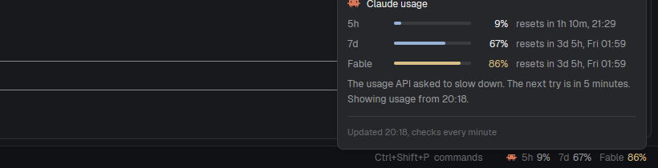

# kz-usage

Plan usage for Claude and Codex in the [Herdr](https://herdr.dev) status bar. The bar shows the 5 hour, 7 day and model limits as percents. Hover over the bar to see the reset times.



## Features

- Claude: the 5 hour session, the 7 day window and the weekly model window (for example Fable), from your Claude Code login
- Codex: the 5 hour and 7 day windows, from your Codex CLI login
- Percents turn yellow at 80 and red at 95
- Hover card: a bar, the percent and the reset time for each window, plus extra usage and spend
- Shows only the providers that you are logged in to
- Checks every minute. All copies of the mod share one result, so a reload or a restart does not send a new request
- After a rate limit or a network error, the bar keeps the last numbers and the card shows their age. After a rate limit, kz-usage waits 5 minutes
- The block width follows the text, so the status bar has no gap and no clipped text

## Install

1. Clone the repo into the Herdr mods folder:

   ```sh
   git clone https://github.com/santikzz/kz-usage ~/.config/herdr-app/mods/kz-usage
   ```

2. Copy a layout. The Herdr layouts are read-only. If you have your own layout, skip this step:

   ```sh
   herdr-app do layout.clone '{"name":"main","as":"my-main"}'
   ```

3. In `~/.config/herdr-app/layouts/my-main.json`, replace the `status` block with this row:

   ```json
   {
     "id": "status",
     "type": "row",
     "resizable": false,
     "size": { "px": 28 },
     "children": [
       { "id": "status-bar", "type": "block", "content": { "mod": "workspace-status" } },
       { "id": "usage", "type": "block", "content": { "mod": "kz-usage" }, "size": { "px": 240 } }
     ]
   }
   ```

4. Check the mod:

   ```sh
   herdr-app check ~/.config/herdr-app/mods/kz-usage
   ```

## Settings

Put settings in `props` on the layout block. All of them are optional:

```json
{ "mod": "kz-usage", "props": { "providers": ["claude", "codex"], "model": "Fable", "dirs": { "claude": "D:/claude-work" } } }
```

| Prop | Default | What it does |
|---|---|---|
| `providers` | Every provider with a login | The providers to show, in this order. A listed provider without a login shows `No login` |
| `model` | The active model window | The Claude weekly model window to show, by its name |
| `dirs` | `~/.claude`, `~/.codex` | The config folder of each provider. Use it when you set `CLAUDE_CONFIG_DIR` or `CODEX_HOME`. A mod cannot read environment variables |

## Providers

| Provider | Login file | Usage endpoint |
|---|---|---|
| Claude | `~/.claude/.credentials.json` | `GET https://api.anthropic.com/api/oauth/usage` |
| Codex | `~/.codex/auth.json` | `GET https://chatgpt.com/backend-api/wham/usage` |

Grok and Gemini are not supported:

- xAI has no usage endpoint for Grok plans.
- The Gemini CLI token expires after one hour, and only the CLI can refresh it.

To add a provider, add an entry to `PROVIDERS` in `providers.js`. Give it a `request()` that builds the request from the login file and a `parse()` that returns the windows.

## Privacy

kz-usage reads your login files. It sends each token only to the API of its own provider. It does not refresh tokens and it does not change your login files. Herdr keeps the last usage numbers (not the tokens) in `shared.json`.

## Limits

- The two usage endpoints are not documented. They can change without notice.
- The Claude endpoint has a strict rate limit. Other tools that use the same login share it. If two tools check every minute, both get rate limits.
- kz-usage does not refresh tokens. When you do not use Claude Code or Codex for some hours, the token expires and the bar shows `Expired`. Start the CLI to get a new token.
- Tested on Windows 10 with Herdr 0.1.16 and a Claude Max plan. Codex, macOS and Linux are not tested.

## Develop

```sh
node providers.test.mjs
herdr-app check ~/.config/herdr-app/mods/kz-usage
```

## License

MIT
