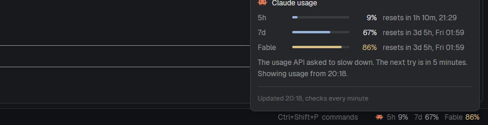

# kz-usage

The right end of the Herdr status bar shows plan usage for Claude and Codex: a provider icon, then the 5 hour, 7 day and weekly model windows as percents. Hover over it and a card opens above the bar with a bar, the percent and the reset time for each window.

## What you see

- **Status bar, right end.** A block 28 px high, the same look as `workspace-status`: `chrome` background, 1 px `border` line at the top, text 11.8 px, 14 px padding left and right.
- **Each provider:** the Herdr program icon at 13 px (`icons/claude.svg`, `icons/codex.svg`), 6 px gap, then the windows 10 px apart. A window is the label in `dim` (`5h`, `7d`, `Fable`), 4 px gap, then the percent in `muted`. 14 px between providers.
- **Hover card,** pinned by its bottom right corner above the bar: `popover` background, 1 px `border`, 8 px corners, medium shadow, 12 px padding, text 12 px.
  - One section for each provider: the icon at 16 px and "Claude usage" in medium weight, then one row for each window: the label (48 px, `muted`), a 96 x 4 px bar (`border` track, `accent` fill), the percent (36 px, right aligned), the reset text (`resets in 3d 5h, Fri 01:59`, `muted`).
  - Notes under the rows in `muted`: `Extra usage on, 12% used`, `Spend 12.34 USD`, `Plan plus`.
  - A footer under a 1 px line: `Updated 20:18, checks every minute`, 11 px, `dim`.

## How it behaves

- Percent and bar color: `ansi3` at 80 or more, `ansi1` at 95 or more, else the default.
- No data yet: `...`. No login file or no token: `No login`. HTTP 401 or 403: `Expired`. Other failures with no earlier data: `--`. The card explains each state and the next step.
- With no `providers` prop, the bar shows only the providers that have a login. If none has one, it shows Claude with `No login`.
- The mod checks for due providers every 15 s. A provider is due 60 s after its last answer, or 5 minutes after a 429.
- After a 429 or a network error, the bar keeps the last numbers. The card adds `The usage API asked to slow down. The next try is in 5 minutes. Showing usage from 20:18.`
- The card opens after 250 ms of hover and closes 200 ms after the pointer leaves the bar and the card.
- When the text width changes, the mod resizes its layout block to fit (`layout.resize`).

## Built from

- **Layout:** the `status` block of a cloned `main` becomes a row (`resizable: false`, 28 px): `workspace-status` (weight) and a `kz-usage` block (240 px at first).
- **Props:** `providers` (list and order), `model` (Claude weekly model window by name), `dirs` (config folder for each provider).
- **providers.js** (no Herdr imports): `PROVIDERS` with `dir`, `file`, `request(auth)` and `parse(json)`; `load()` returns `{state, windows: [{label, percent, resets}], notes}` as plain data, with `resets` in epoch ms.
  - Claude: `claudeAiOauth.accessToken` from `~/.claude/.credentials.json`. If that file is missing on macOS (no `dirs` prop), the mod runs `security find-generic-password -s "Claude Code-credentials" -w`: Claude Code keeps the login in the Keychain there. `GET https://api.anthropic.com/api/oauth/usage` with `Authorization: Bearer` and `anthropic-beta: oauth-2025-04-20`. Reads `limits[]`: `session`, `weekly_all`, `weekly_scoped` (name from `scope.model.display_name`, prefer `is_active`). Falls back to `five_hour` and `seven_day.utilization`. Notes from `extra_usage` and `spend`.
  - Codex: `tokens.access_token` and `tokens.account_id` from `~/.codex/auth.json`. `GET https://chatgpt.com/backend-api/wham/usage` with `Authorization: Bearer`, `ChatGPT-Account-Id` and `User-Agent: codex-cli`. Reads `rate_limit.primary_window` and `secondary_window`: `used_percent`, `limit_window_seconds` (label: `5h`, `7d`), `reset_at` (unix seconds) or `reset_after_seconds`.
- **main.js:** `herdr` `readTextFile`, `home`, `shared`, `setShared`, `layout`, `run("layout.resize")`, `checking`; `gpui-base` `HoverCard` with `trigger` and `content`; `on_size_change` on the bar.
- **Cache:** `shared("kz-usage:[model,dirs]")` = `{pending, data: {claude: {...result, at, next}}}`. Every copy reads it, so one request a minute reaches each endpoint, also through reloads and restarts.

## Watch out

- A plain `div` cannot draw outside its 28 px block. The `HoverCard` content draws in the window's top layer, so the card can open above the bar.
- The Claude endpoint gives 429 at about two requests a minute for one login. Each mod reload used to send a request: keep the numbers in `shared()`, not in the copy.
- `fetch` has no timeout. Without the 30 s `pending` limit, one lost request stops all later checks.
- Mods cannot read `CLAUDE_CONFIG_DIR` or `CODEX_HOME`, so the `dirs` prop exists.
- Put `flex_none()` on the measured bar. Without it, the bar shrinks to the block and the auto width never grows.
- Herdr keeps the size from `layout.resize` as a layout click in `layouts/.state/`.

## Done when

- `node providers.test.mjs` prints `ok`.
- `herdr-app check ~/.config/herdr-app/mods/kz-usage` passes.
- With a Claude login, the status bar shows the Claude icon and `5h`, `7d` and the model window with percents that match `claude /usage`.
- A hover on the bar opens the card with three rows and reset times in local time.
- With no login files, the bar shows `No login` and the card says how to log in.
- Two copies of the mod and a reload send at most one request a minute.
